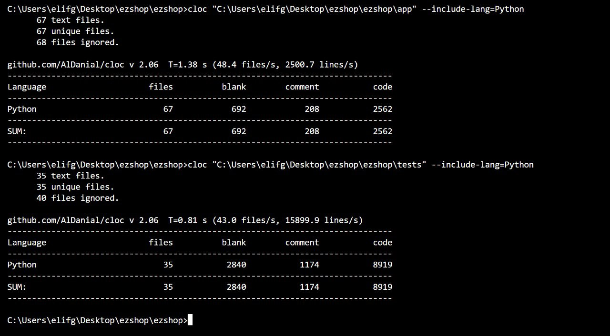

# Project Estimation part 2

Goal of this document is to compare actual effort, size and productivity of the project, vs the estimates made in task1.

## Computation of size

To compute the lines of code use cloc    
To install cloc:  
           `npm install -g cloc`   
On Windows, also a perl interpreter needs to be installed. You find it here https://strawberryperl.com/  
To run cloc  
           `cloc <directory containing py files> --include-lang=Python`  
As a result of cloc collect the *code* value (rightmost column of the result table)  
        

Compute two separate values of size  
-LOC of production code     `cloc <EzShop\app> --include-lang=Python`  
-LOC of test code      `cloc <EzShop\tests> --include-lang=Python`  

## Computation of effort 
From timesheet.md sum all effort spent, in **ALL** activities (task1, task2, task3) at the end of the project on Jan 18. 

TOTAL=343 h

## Computation of productivity

productivity = ((LOC of production code)+ (LOC of test code)) / effort = 33 loc/hour

## Comparison

|                                        | Estimated (end of task 1) | Actual (jan 18, end of task 3)|
| -------------------------------------------------------------------------------- | -------- |----|
| production code size | unknown  |2562|
| test code size | unknown |8919|
| total size  |6000 LOC|11481 LOC|
| effort ||343 h|
| productivity  | 10 loc / hour |33 loc/hour|

Report, as estimate of effort, the value obtained via activity decomposition technique.  The comparison is meaningful for productivity, since the stimates for size and effort were not based on the Official requirements.
