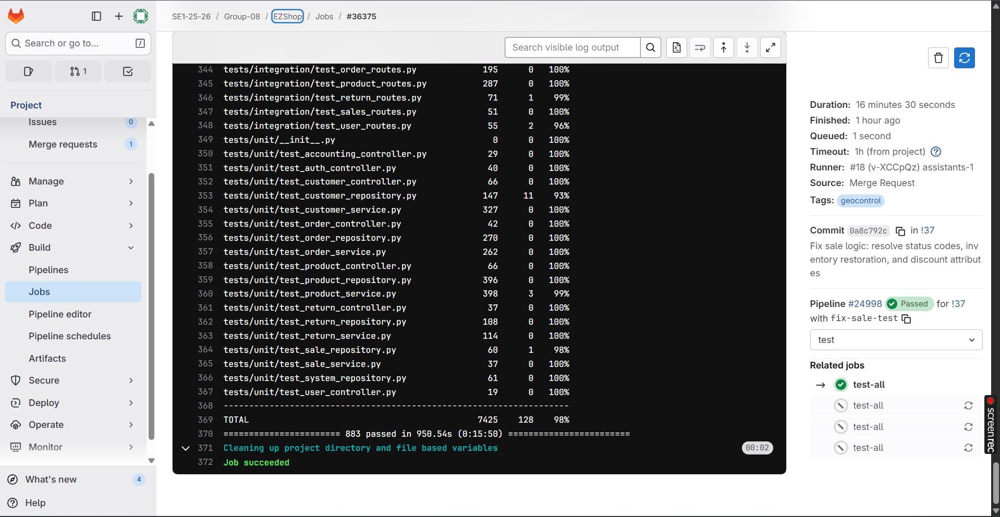

# Test Report

<The goal of this document is to explain how the application was tested, detailing how the test cases were defined and what they cover>

# Contents

- [Test Report](#test-report)
- [Contents](#contents)
- [Dependency graph](#dependency-graph)
- [Integration approach](#integration-approach)
- [Tests](#tests)
- [Coverage](#coverage)
  - [Coverage of FR](#coverage-of-fr)
  - [Coverage white box](#coverage-white-box)

# Dependency graph

     <report the here the dependency graph of EzShop>
  

# Integration approach

    <Write here the integration sequence you adopted, in general terms (top down, bottom up, mixed) and as sequence

    (ex: step1: unit A, step 2: unit A+B, step 3: unit A+B+C, etc)>

    <Some steps may  correspond to unit testing (ex step1 in ex above)>

    <One step will  correspond to API testing >
   
    
1. Integration Approach

Strategy:
 We adopted a Mixed (Incremental) Integration Strategy structured around Vertical Slicing.

   •	Vertical Slicing: Instead of separating work by technical layers (e.g., one person doing only DB), each team member was responsible for the full stack implementation of a specific functional domain (Model, DAO, Controller, and Routes).

   •	Bottom-Up Coding: Within each vertical slice, we followed a bottom-up coding sequence: DAO -> DTO -> Repository -> Controller -> Route. We built the persistent storage layer first to ensure data integrity before adding business logic and API endpoints.
 
   •	Incremental Integration: We utilized a Feature Branch workflow on GitLab. Distinct functional features were developed on separate branches and integrated incrementally into the main development branch (dev) via Merge Requests.
   
Integration Sequence:
The integration followed a logical dependency chain based on our role allocation:

   •	Step 1: User Management & Authentication. (Member 1)
     	 
   Result: Established the security context (Roles, JWT), allowing subsequent modules to implement Role-Based Access Control.

   •	Step 2: Products, Warehouse & Supply Chain. (Member 2)
       
   Result: Provided the catalog and stock data structures required for sales and orders.

   •	Step 3: Sales Transactions (Members 3 )
       
   Result: Connected the "Cash Register" logic to the Inventory (decreasing stock upon sale)

  •	  Step 4: Customer Loyalty. (Members 4)
       
   Result: Create customer loyalty cards an points.

   •	Step 5: Accounting & Returns. (Member 5)
       
   Result: The final integration step, as the Returns logic required existing Sales data and had to interact with Inventory to restore stock levels.
________________________________________
2. Unit Testing Strategy

Approach:
 We performed White Box Testing using pytest. After implementing the code for a vertical slice, each member wrote unit tests to verify their own domain logic before integration.

Scope & Methodology:

 • Isolation: We tested individual DAOs and Controllers to ensure internal business rules were correct (e.g., verifying that a password is hashed before saving).
     
 • Coverage: Tests focused on validating the "Functional Responsibilities" defined in our project plan. For example, ensuring that the logic for issuing an order correctly records the transaction in the database.
________________________________________
3. API Testing Strategy

Approach:
 We utilized a Black Box / Acceptance Testing approach driven by the provided OpenAPI (Swagger) specifications.

Process:

 • Validation: After our internal unit tests passed, we ran the external Test Suite (Professor's) against our integrated application.

 • Compliance: This phase ensured that our implementation strictly adhered to the interface contract. We verified that endpoints such as POST/auth and GET/balance returned the exact JSON structure and HTTP status codes required by the specification, treating the system as a "closed box".
________________________________________
4. Main Challenges & Critical Integration Points

Challenge:
 Because each member worked on an isolated functional domain, the primary challenge was ensuring Cross-Module Data Consistency when one module needed to update data owned by another. We successfully managed the following critical integration points:

 •	Inventory Synchronization (Sales -> Inventory):
The Sales module had to interact with the Inventory module. We ensured that when POST /sales/{id}/items was called, the system checked stock availability in the product_repository before allowing the sale.
 
 •	Returns Management (Returns -> Inventory):
A complex challenge was the "Closing Returns" logic. When a return was finalized via PATCH /returns/{id}/close, the system had to trigger a product_repository update to physically restore the item to the shelf, ensuring the warehouse count reflected the returned goods.
 
 •	Supply Chain Updates (Order Arrival):
We implemented logic to ensure that the PATCH /orders/{id}/arrival endpoint automatically triggered a quantity increase in the product_repository upon the arrival of a supplier order.
 
 •	Loyalty Calculation (Sales -> Customers):
Calculating loyalty points required a dependency between the Sales module (which knows the transaction value) and the Customer module. We ensured the GET /sales/{id}/points endpoint correctly utilized logic shared with the Customer domain.

# Tests

<in the table below list the test cases defined For each test report the object tested, the test level (API, integration, unit) and the technique used to define the test case (BB/ eq partitioning, BB/ boundary, WB/ statement coverage, etc)> <split the table if needed>

| Test case name | Object(s) tested | Test level | Technique used |
| :------------: | :--------------: | :--------: | :------------: |
| test_create_user_route_success | UserRoutes | API | BB / Eq. Partitioning |
| test_create_user_missing_password | UserRoutes | API | BB / Boundary |
| test_get_user_not_found | UserRoutes | API | BB / Eq. Partitioning |
| test_create_user_empty_password | UserRoutes | API | BB / Boundary |
| test_create_user_empty_type | UserRoutes | API | BB / Boundary |
| test_get_token_success | AuthController | Unit | WB / Statement Coverage |
| test_get_token_user_not_found | AuthController | Unit | WB / Branch Coverage |
| test_get_token_wrong_password | AuthController | Unit | WB / Branch Coverage |
| test_create_user_success | UserController | Unit | WB / Statement Coverage |
| test_create_customer_card_success | CustomerRoutes | API | BB / Eq. Partitioning |
| test_create_customer_card_unauthenticated | CustomerRoutes | API | BB / Boundary (auth) |
| test_create_customer_success | CustomerRoutes | API | BB / Eq. Partitioning |
| test_create_customer_bad_request | CustomerRoutes | API | BB / Boundary + Eq. Partitioning |
| test_create_customer_unauthenticated | CustomerRoutes | API | BB / Boundary (auth) |
| test_create_customer_with_invalid_card | CustomerRoutes | API | BB / Eq. Partitioning |
| test_list_customers_success | CustomerRoutes | API | BB / Eq. Partitioning |
| test_list_customers_unauthenticated | CustomerRoutes | API | BB / Boundary (auth) |
| test_list_customers_includes_created | CustomerRoutes | API | BB / Eq. Partitioning |
| test_get_customer_by_id_success | CustomerRoutes | API | BB / Eq. Partitioning |
| test_get_customer_not_found | CustomerRoutes | API | BB / Eq. Partitioning |
| test_get_customer_invalid_id | CustomerRoutes | API | BB / Boundary |
| test_get_customer_unauthenticated | CustomerRoutes | API | BB / Boundary (auth) |
| test_update_customer_success | CustomerRoutes | API | BB / Eq. Partitioning |
| test_update_customer_not_found | CustomerRoutes | API | BB / Eq. Partitioning |
| test_update_customer_invalid_payload | CustomerRoutes | API | BB / Boundary |
| test_update_customer_unauthenticated | CustomerRoutes | API | BB / Boundary (auth) |
| test_update_customer_invalid_id | CustomerRoutes | API | BB / Boundary |
| test_update_customer_no_changes | CustomerRoutes | API | BB / Eq. Partitioning |
| test_delete_customer_success | CustomerRoutes | API | BB / Eq. Partitioning |
| test_delete_customer_not_found | CustomerRoutes | API | BB / Eq. Partitioning |
| test_delete_customer_unauthenticated | CustomerRoutes | API | BB / Boundary (auth) |
| test_attach_card_to_customer_success | CustomerRoutes | API | BB / Eq. Partitioning |
| test_attach_card_customer_not_found | CustomerRoutes | API | BB / Eq. Partitioning |
| test_attach_card_not_found | CustomerRoutes | API | BB / Eq. Partitioning |
| test_attach_card_already_attached | CustomerRoutes | API | BB / Eq. Partitioning |
| test_attach_card_unauthenticated | CustomerRoutes | API | BB / Boundary (auth) |
| test_modify_card_points_add | CustomerRoutes | API | BB / Eq. Partitioning |
| test_modify_card_points_remove | CustomerRoutes | API | BB / Eq. Partitioning |
| test_modify_card_points_insufficient | CustomerRoutes | API | BB / Boundary (insufficient points) |
| test_modify_card_points_not_found | CustomerRoutes | API | BB / Eq. Partitioning |
| test_modify_card_points_unauthenticated | CustomerRoutes | API | BB / Boundary (auth) |
| test_modify_card_points_as_role | CustomerRoutes | API | BB / Eq. Partitioning |
| test_customer_lifecycle | CustomerRoutes | Integration | Scenario-based (End-to-End flow) |
| test_create_customer_with_card_success | CustomerRoutes | Integration | Scenario-based (customer + card association) |
| test_create_customer_with_valid_card_already_assigned | CustomerRoutes | Integration | BB / Eq. Partitioning |
| test_post_customers_201_created_with_card | CustomerRoutes | Integration | BB / Eq. Partitioning |
| test_post_customers_400_invalid_input | CustomerRoutes | Integration | BB / Boundary + Eq. Partitioning |
| test_get_customers_200_list_of_customers | CustomerRoutes | Integration | BB / Eq. Partitioning |
| test_get_customer_200_found | CustomerRoutes | Integration | BB / Eq. Partitioning |
| test_get_customer_400_invalid_id | CustomerRoutes | Integration | BB / Boundary |
| test_get_customer_404_not_found | CustomerRoutes | Integration | BB / Eq. Partitioning |
| test_put_customer_201_updated | CustomerRoutes | Integration | BB / Eq. Partitioning |
| test_put_customer_400_invalid_input | CustomerRoutes | Integration | BB / Boundary |
| test_put_customer_404_not_found | CustomerRoutes | Integration | BB / Eq. Partitioning |
| test_put_customer_409_conflict | CustomerRoutes | Integration | BB / Eq. Partitioning |
| test_delete_customer_204_deleted | CustomerRoutes | Integration | BB / Eq. Partitioning |
| test_delete_customer_404_not_found | CustomerRoutes | Integration | BB / Eq. Partitioning |
| test_post_customers_cards_201_created | CustomerRoutes | Integration | BB / Eq. Partitioning |
| test_patch_attach_card_201_attached | CustomerRoutes | Integration | BB / Eq. Partitioning |
| test_patch_attach_card_400_invalid_ids | CustomerRoutes | Integration | BB / Boundary |
| test_patch_attach_card_404_not_found | CustomerRoutes | Integration | BB / Eq. Partitioning |
| test_patch_attach_card_409_already_attached | CustomerRoutes | Integration | BB / Eq. Partitioning |
| test_patch_cards_add_points_success | CustomerRoutes | Integration | BB / Eq. Partitioning |
| test_patch_cards_subtract_points_success | CustomerRoutes | Integration | BB / Eq. Partitioning |
| test_patch_cards_insufficient_points | CustomerRoutes | Integration | BB / Boundary |
| test_patch_cards_card_id_404_not_found | CustomerRoutes | Integration | BB / Eq. Partitioning |
| test_create_customer_calls_service | CustomerController | Unit | WB / Statement Coverage |
| test_get_customer_calls_service | CustomerController | Unit | WB / Statement Coverage |
| test_list_customers_calls_service | CustomerController | Unit | WB / Statement Coverage |
| test_update_customer_calls_service | CustomerController | Unit | WB / Statement Coverage |
| test_delete_customer_calls_service | CustomerController | Unit | WB / Statement Coverage |
| test_create_card_calls_service | CustomerController | Unit | WB / Statement Coverage |
| test_attach_card_calls_service | CustomerController | Unit | WB / Statement Coverage |
| test_update_card_points_calls_service | CustomerController | Unit | WB / Statement Coverage |
| test_get_card_calls_service | CustomerController | Unit | WB / Statement Coverage |
| test_create_customer_success | CustomerRepository | Unit | WB / Statement Coverage |
| test_create_customer_conflict | CustomerRepository | Unit | WB / Branch Coverage |
| test_get_customer_by_name_and_list | CustomerRepository | Unit | WB / Statement Coverage |
| test_delete_customer | CustomerRepository | Unit | WB / Statement Coverage |
| test_update_customer_name_only | CustomerRepository | Unit | WB / Statement Coverage |
| test_update_customer_detach_card | CustomerRepository | Unit | WB / Statement Coverage |
| test_update_customer_update_card_points | CustomerRepository | Unit | WB / Statement Coverage |
| test_update_customer_card_points_no_existing_card | CustomerRepository | Unit | WB / Branch Coverage |
| test_create_card_success | CustomerRepository | Unit | WB / Statement Coverage |
| test_create_card_conflict | CustomerRepository | Unit | WB / Branch Coverage |
| test_attach_card_conflict_customer_already_has_card | CustomerRepository | Unit | WB / Branch Coverage |
| test_attach_card_success | CustomerRepository | Unit | WB / Statement Coverage |
| test_attach_card_conflicts | CustomerRepository | Unit | WB / Branch Coverage |
| test_attach_card_missing_customer_or_card | CustomerRepository | Unit | WB / Eq. Partitioning |
| test_update_card_points_success | CustomerRepository | Unit | WB / Statement Coverage |
| test_update_card_points_not_found | CustomerRepository | Unit | WB / Branch Coverage |
| test_create_customer_ok_without_card | CustomerService | Unit | WB / Statement Coverage |
| test_create_customer_invalid_id_raises_bad_request | CustomerService | Unit | WB / Branch Coverage |
| test_create_customer_repo_returns_none_raises | CustomerService | Unit | WB / Branch Coverage |
| test_create_customer_with_existing_card_raises_conflict | CustomerService | Unit | WB / Branch Coverage |
| test_create_customer_with_card_attaches_existing_card | CustomerService | Unit | WB / Statement Coverage |
| test_create_customer_card_creation_fails | CustomerService | Unit | WB / Branch Coverage |
| test_create_customer_card_generation_fails_after_retries | CustomerService | Unit | WB / Branch Coverage |
| test_create_customer_card_ok | CustomerService | Unit | WB / Statement Coverage |
| test_get_customer_not_found_raises | CustomerService | Unit | WB / Branch Coverage |
| test_get_customer_ok | CustomerService | Unit | WB / Statement Coverage |
| test_get_customer_ok_uses_repo | CustomerService | Unit | WB / Statement Coverage |
| test_get_customer_invalid_id_raises_bad_request | CustomerService | Unit | WB / Branch Coverage |
| test_get_customer_not_found_raises_not_found | CustomerService | Unit | WB / Branch Coverage |
| test_update_customer_invalid_id_raises | CustomerService | Unit | WB / Branch Coverage |
| test_update_customer_not_found_raises | CustomerService | Unit | WB / Branch Coverage |
| test_update_customer_repo_returns_none_raises | CustomerService | Unit | WB / Branch Coverage |
| test_update_customer_ok | CustomerService | Unit | WB / Statement Coverage |
| test_delete_customer_ok | CustomerService | Unit | WB / Statement Coverage |
| test_delete_customer_non_existing_raises | CustomerService | Unit | WB / Branch Coverage |
| test_get_card_not_found_raises | CustomerService | Unit | WB / Branch Coverage |
| test_create_card_repo_returns_none_raises | CustomerService | Unit | WB / Branch Coverage |
| test_get_card_ok | CustomerService | Unit | WB / Statement Coverage |
| test_attach_card_empty_card_id_raises | CustomerService | Unit | WB / Branch Coverage |
| test_attach_card_card_not_found_raises | CustomerService | Unit | WB / Branch Coverage |
| test_attach_card_repo_returns_none_raises | CustomerService | Unit | WB / Branch Coverage |
| test_attach_card_customer_already_has_card_raises | CustomerService | Unit | WB / Branch Coverage |
| test_attach_card_success | CustomerService | Unit | WB / Statement Coverage |
| test_check_customer_has_card_ok | CustomerService | Unit | WB / Statement Coverage |
| test_check_customer_has_card_raises_conflict | CustomerService | Unit | WB / Branch Coverage |
| test_check_card_attached_ok | CustomerService | Unit | WB / Statement Coverage |
| test_check_card_attached_raises_conflict | CustomerService | Unit | WB / Branch Coverage |
| test_to_customer_response_without_card | CustomerService | Unit | WB / Statement Coverage |
| test_to_customer_response_with_card | CustomerService | Unit | WB / Statement Coverage |
| test_update_card_points_card_not_found_raises | CustomerService | Unit | WB / Branch Coverage |
| test_update_card_points_adds_points | CustomerService | Unit | WB / Statement Coverage |
| test_update_card_points_subtracts_points | CustomerService | Unit | WB / Statement Coverage |
| test_update_card_points_insufficient_points_raises | CustomerService | Unit | WB / Branch Coverage |
| test_update_card_points_invalid_card_id_raises | CustomerService | Unit | WB / Branch Coverage |
| test_get_card_empty_id_raises | CustomerService | Unit | WB / Branch Coverage |
| test_get_card_by_card_id_empty_returns_none | CustomerService | Unit | WB / Statement Coverage |
| test_post_products_201_created | ProductRoutes | API | BB / Eq. Partitioning |
| test_get_products_reorder_200_empty_list | ProductRoutes | API | BB / Boundary |
| test_post_products_201_created_without_optional_fields | ProductRoutes | API | BB / Boundary |
| test_post_products_400_invalid_barcode | ProductRoutes | API | BB / Eq. Partitioning |
| test_post_products_400_negative_price | ProductRoutes | API | BB / Boundary |
| test_post_products_400_negative_quantity | ProductRoutes | API | BB / Boundary |
| test_post_products_409_duplicate_barcode | ProductRoutes | API | BB / Eq. Partitioning |
| test_put_product_201_updated | ProductRoutes | API | BB / Eq. Partitioning |
| test_put_product_201_partial_update | ProductRoutes | API | BB / Boundary |
| test_put_product_422_invalid_input | ProductRoutes | API | BB / Boundary |
| test_put_product_404_not_found | ProductRoutes | API | BB / Eq. Partitioning |
| test_put_product_409_barcode_conflict | ProductRoutes | API | BB / Eq. Partitioning |
| test_put_product_409_barcode_has_active_sales | ProductRoutes | API | BB / Eq. Partitioning |
| test_create_product_ok | ProductService | Unit | WB / Statement Coverage |
| test_create_product_invalid_barcode_raises | ProductService | Unit | WB / Branch Coverage |
| test_create_product_invalid_price_raises | ProductService | Unit | WB / Branch Coverage |
| test_create_product_negative_quantity_raises | ProductService | Unit | WB / Branch Coverage |
| test_create_product_invalid_position_raises | ProductService | Unit | WB / Branch Coverage |
| test_create_product_without_optional_fields | ProductService | Unit | WB / Branch Coverage |
| test_create_product_repo_failure_raises | ProductService | Unit | WB / Branch Coverage |
| test_update_product_ok | ProductService | Unit | WB / Statement Coverage |
| test_update_product_invalid_id_raises | ProductService | Unit | WB / Branch Coverage |
| test_update_product_not_found_raises | ProductService | Unit | WB / Branch Coverage |
| test_update_product_barcode_with_active_sales_raises | ProductService | Unit | WB / Branch Coverage |
| test_update_product_invalid_new_barcode_raises | ProductService | Unit | WB / Branch Coverage |
| test_update_product_repo_not_found_raises | ProductService | Unit | WB / Branch Coverage |
| test_update_product_triggers_quantity_validation | ProductService | Unit | WB / Branch Coverage |
| test_update_product_triggers_position_validation | ProductService | Unit | WB / Branch Coverage |
| test_get_products_needing_reorder_empty | ProductService | Unit | WB / Branch Coverage |
| test_get_products_needing_reorder_ok | ProductService | Unit | WB / Statement Coverage |
| test_get_product_by_barcode_invalid_check_digit_raises | ProductService | Unit | WB / Branch Coverage |
| test_create_product_success | ProductRepository | Unit | WB / Statement Coverage |
| test_create_product_duplicate_barcode_raises | ProductRepository | Unit | WB / Branch Coverage |
| test_create_product_sets_all_fields | ProductRepository | Unit | WB / Statement Coverage |
| test_update_product_success | ProductRepository | Unit | WB / Statement Coverage |
| test_update_product_not_found_returns_none | ProductRepository | Unit | WB / Branch Coverage |
| test_update_product_barcode_conflict_raises | ProductRepository | Unit | WB / Branch Coverage |
| test_update_product_same_barcode_allowed | ProductRepository | Unit | WB / Branch Coverage |
| test_update_product_partial_update | ProductRepository | Unit | WB / Statement Coverage |
| test_update_product_quantity_field | ProductRepository | Unit | WB / Statement Coverage |
| test_get_products_needing_reorder_with_low_stock_products | ProductRepository | Unit | WB / Statement Coverage |
| test_create_product_duplicate_position_raises | ProductRepository | Unit | WB / Branch Coverage |
| test_update_product_position_duplicate_position_raises | ProductRepository | Unit | WB / Branch Coverage |
| test_update_product_quantity_field | ProductRepository | Unit | WB / Statement Coverage |
| test_create_product_calls_service | ProductController | Unit | WB / Statement Coverage |
| test_update_product_calls_service | ProductController | Unit | WB / Statement Coverage |
| test_get_products_needing_reorder_calls_service | ProductController | Unit | WB / Statement Coverage |
| test_delete_product_204_deleted | ProductRoutes | API | BB / Eq. Partitioning |
| test_delete_product_422_invalid_id | ProductRoutes | API | BB / Boundary |
| test_delete_product_404_not_found | ProductRoutes | API | BB / Eq. Partitioning |
| test_delete_product_409_has_active_sales | ProductRoutes | API | BB / Eq. Partitioning |
| test_delete_product_409_has_active_orders | ProductRoutes | API | BB / Eq. Partitioning |
| test_delete_product_ok | ProductService | Unit | WB / Statement Coverage |
| test_delete_product_invalid_id_raises | ProductService | Unit | WB / Branch Coverage |
| test_delete_product_with_active_sales_raises | ProductService | Unit | WB / Branch Coverage |
| test_delete_product_with_active_orders_raises | ProductService | Unit | WB / Branch Coverage |
| test_delete_product_with_active_returns_raises | ProductService | Unit | WB / Branch Coverage |
| test_delete_product_with_multiple_conflicts_raises | ProductService | Unit | WB / Branch Coverage |
| test_delete_product_repo_not_found_raises | ProductService | Unit | WB / Branch Coverage |
| test_delete_product_success | ProductRepository | Unit | WB / Statement Coverage |
| test_delete_product_not_found_returns_false | ProductRepository | Unit | WB / Branch Coverage |
| test_delete_product_calls_service | ProductController | Unit | WB / Statement Coverage |
| test_get_products_200_list_of_products | ProductRoutes | API | BB / Eq. Partitioning |
| test_get_products_200_empty_list | ProductRoutes | API | BB / Boundary |
| test_list_products_empty | ProductService | Unit | WB / Branch Coverage |
| test_list_products_multiple | ProductService | Unit | WB / Statement Coverage |
| test_list_products_success | ProductRepository | Unit | WB / Statement Coverage |
| test_list_products_empty | ProductRepository | Unit | WB / Branch Coverage |
| test_list_products_calls_service | ProductController | Unit | WB / Statement Coverage |
| test_get_products_search_200_found | ProductRoutes | API | BB / Eq. Partitioning |
| test_get_products_search_200_no_results | ProductRoutes | API | BB / Boundary |
| test_get_products_search_422_missing_description | ProductRoutes | API | BB / Boundary |
| test_get_products_search_400_empty_description | ProductRoutes | API | BB / Boundary |
| test_get_product_by_barcode_200_found | ProductRoutes | API | BB / Eq. Partitioning |
| test_get_product_by_barcode_422_invalid_format | ProductRoutes | API | BB / Boundary |
| test_get_product_by_barcode_404_not_found | ProductRoutes | API | BB / Eq. Partitioning |
| test_get_product_200_found | ProductRoutes | API | BB / Eq. Partitioning |
| test_get_product_422_invalid_id | ProductRoutes | API | BB / Boundary |
| test_get_product_404_not_found | ProductRoutes | API | BB / Eq. Partitioning |
| test_get_product_ok | ProductService | Unit | WB / Statement Coverage |
| test_get_product_invalid_id_raises | ProductService | Unit | WB / Branch Coverage |
| test_get_product_not_found_raises | ProductService | Unit | WB / Branch Coverage |
| test_get_product_by_barcode_ok | ProductService | Unit | WB / Statement Coverage |
| test_get_product_by_barcode_invalid_barcode_raises | ProductService | Unit | WB / Branch Coverage |
| test_get_product_by_barcode_not_found_raises | ProductService | Unit | WB / Branch Coverage |
| test_search_products_ok | ProductService | Unit | WB / Statement Coverage |
| test_search_products_empty_description_raises | ProductService | Unit | WB / Branch Coverage |
| test_search_products_whitespace_only_raises | ProductService | Unit | WB / Branch Coverage |
| test_search_products_no_results | ProductService | Unit | WB / Branch Coverage |
| test_get_product_internal_method_found | ProductService | Unit | WB / Statement Coverage |
| test_get_product_internal_method_not_found | ProductService | Unit | WB / Branch Coverage |
| test_get_product_internal_method_invalid_id | ProductService | Unit | WB / Branch Coverage |
| test_get_product_by_id_found | ProductRepository | Unit | WB / Statement Coverage |
| test_get_product_by_id_not_found | ProductRepository | Unit | WB / Branch Coverage |
| test_get_product_by_barcode_found | ProductRepository | Unit | WB / Statement Coverage |
| test_get_product_by_barcode_not_found | ProductRepository | Unit | WB / Branch Coverage |
| test_search_products_by_description_found | ProductRepository | Unit | WB / Statement Coverage |
| test_search_products_by_description_no_results | ProductRepository | Unit | WB / Branch Coverage |
| test_get_product_calls_service | ProductController | Unit | WB / Statement Coverage |
| test_get_product_by_barcode_calls_service | ProductController | Unit | WB / Statement Coverage |
| test_search_products_calls_service | ProductController | Unit | WB / Statement Coverage |
| test_patch_product_quantity_201_add_quantity | ProductRoutes | API | BB / Eq. Partitioning |
| test_patch_product_quantity_201_subtract_quantity | ProductRoutes | API | BB / Eq. Partitioning |
| test_patch_product_quantity_201_set_to_zero | ProductRoutes | API | BB / Boundary |
| test_patch_product_quantity_422_missing_query | ProductRoutes | API | BB / Boundary |
| test_patch_product_quantity_400_negative_result | ProductRoutes | API | BB / Boundary |
| test_patch_product_quantity_404_not_found | ProductRoutes | API | BB / Eq. Partitioning |
| test_update_product_quantity_add_ok | ProductService | Unit | WB / Statement Coverage |
| test_update_product_quantity_subtract_ok | ProductService | Unit | WB / Statement Coverage |
| test_update_product_quantity_invalid_id_raises | ProductService | Unit | WB / Branch Coverage |
| test_update_product_quantity_negative_result_raises | ProductService | Unit | WB / Branch Coverage |
| test_update_quantity_repo_not_found_raises | ProductService | Unit | WB / Branch Coverage |
| test_update_product_quantity_add_success | ProductRepository | Unit | WB / Statement Coverage |
| test_update_product_quantity_subtract_success | ProductRepository | Unit | WB / Statement Coverage |
| test_update_product_quantity_not_found_returns_none | ProductRepository | Unit | WB / Branch Coverage |
| test_update_product_quantity_negative_result_raises | ProductRepository | Unit | WB / Branch Coverage |
| test_update_product_quantity_to_zero | ProductRepository | Unit | WB / Boundary |
| test_update_product_quantity_calls_service | ProductController | Unit | WB / Statement Coverage |
| test_patch_product_position_201_updated | ProductRoutes | API | BB / Eq. Partitioning |
| test_patch_product_position_201_clear_position | ProductRoutes | API | BB / Boundary |
| test_patch_product_position_422_missing_query | ProductRoutes | API | BB / Boundary |
| test_patch_product_position_400_invalid_format | ProductRoutes | API | BB / Eq. Partitioning |
| test_patch_product_position_404_not_found | ProductRoutes | API | BB / Eq. Partitioning |
| test_update_product_position_ok | ProductService | Unit | WB / Statement Coverage |
| test_update_product_position_invalid_format_raises | ProductService | Unit | WB / Branch Coverage |
| test_update_product_position_to_null | ProductService | Unit | WB / Branch Coverage |
| test_update_product_position_empty_string | ProductService | Unit | WB / Branch Coverage |
| test_update_position_repo_not_found_raises | ProductService | Unit | WB / Branch Coverage |
| test_validate_position_empty_string_does_not_raise | ProductService | Unit | WB / Branch Coverage |
| test_update_product_position_success | ProductRepository | Unit | WB / Statement Coverage |
| test_update_product_position_not_found_returns_none | ProductRepository | Unit | WB / Branch Coverage |
| test_update_product_position_to_none | ProductRepository | Unit | WB / Branch Coverage |
| test_update_product_position_calls_service | ProductController | Unit | WB / Statement Coverage |
| test_post_payfor_201_created | OrderRoutes | API | BB / Eq. Partitioning |
| test_post_payfor_400_invalid_barcode | OrderRoutes | API | BB / Eq. Partitioning |
| test_post_payfor_400_negative_quantity | OrderRoutes | API | BB / Boundary |
| test_post_payfor_404_product_not_found | OrderRoutes | API | BB / Eq. Partitioning |
| test_create_and_pay_order_success | OrderService | Unit | WB / Statement Coverage |
| test_create_and_pay_order_invalid_barcode_raises | OrderService | Unit | WB / Branch Coverage |
| test_create_and_pay_order_invalid_quantity_raises | OrderService | Unit | WB / Branch Coverage |
| test_create_and_pay_order_product_not_found_raises | OrderService | Unit | WB / Branch Coverage |
| test_create_and_pay_order_repo_returns_none_raises | OrderService | Unit | WB / Branch Coverage |
| test_create_and_pay_order_success | OrderRepository | Unit | WB / Statement Coverage |
| test_create_and_pay_order_uses_product_price | OrderRepository | Unit | WB / Statement Coverage |
| test_create_and_pay_order_product_not_found_raises | OrderRepository | Unit | WB / Branch Coverage |
| test_create_and_pay_order_calls_service | OrderController | Unit | WB / Statement Coverage |
| test_post_orders_201_created | OrderRoutes | API | BB / Eq. Partitioning |
| test_post_orders_400_invalid_barcode | OrderRoutes | API | BB / Eq. Partitioning |
| test_post_orders_400_empty_barcode | OrderRoutes | API | BB / Boundary |
| test_post_orders_400_negative_quantity | OrderRoutes | API | BB / Boundary |
| test_post_orders_400_zero_quantity | OrderRoutes | API | BB / Boundary |
| test_post_orders_400_negative_price | OrderRoutes | API | BB / Boundary |
| test_post_orders_400_zero_price | OrderRoutes | API | BB / Boundary |
| test_post_orders_404_product_not_found | OrderRoutes | API | BB / Eq. Partitioning |
| test_patch_pay_order_201_success | OrderRoutes | API | BB / Eq. Partitioning |
| test_patch_pay_order_422_invalid_id | OrderRoutes | API | BB / Boundary |
| test_patch_pay_order_404_not_found | OrderRoutes | API | BB / Eq. Partitioning |
| test_patch_pay_order_409_wrong_status | OrderRoutes | API | BB / Eq. Partitioning |
| test_patch_pay_order_409_already_completed | OrderRoutes | API | BB / Eq. Partitioning |
| test_create_order_success | OrderService | Unit | WB / Statement Coverage |
| test_create_order_invalid_barcode_empty_raises | OrderService | Unit | WB / Branch Coverage |
| test_create_order_invalid_barcode_whitespace_raises | OrderService | Unit | WB / Branch Coverage |
| test_create_order_invalid_barcode_format_raises | OrderService | Unit | WB / Branch Coverage |
| test_create_order_invalid_barcode_non_numeric_raises | OrderService | Unit | WB / Branch Coverage |
| test_create_order_zero_quantity_raises | OrderService | Unit | WB / Branch Coverage |
| test_create_order_negative_quantity_raises | OrderService | Unit | WB / Branch Coverage |
| test_create_order_zero_price_raises | OrderService | Unit | WB / Branch Coverage |
| test_create_order_negative_price_raises | OrderService | Unit | WB / Branch Coverage |
| test_create_order_product_not_found_raises | OrderService | Unit | WB / Branch Coverage |
| test_create_order_repo_returns_none_raises | OrderService | Unit | WB / Branch Coverage |
| test_pay_order_success | OrderService | Unit | WB / Statement Coverage |
| test_pay_order_invalid_id_raises | OrderService | Unit | WB / Branch Coverage |
| test_pay_order_not_found_raises | OrderService | Unit | WB / Branch Coverage |
| test_pay_order_wrong_status_raises | OrderService | Unit | WB / Branch Coverage |
| test_pay_order_repo_returns_none_raises | OrderService | Unit | WB / Branch Coverage |
| test_create_order_success | OrderRepository | Unit | WB / Statement Coverage |
| test_create_order_product_not_found_raises | OrderRepository | Unit | WB / Branch Coverage |
| test_create_order_sets_issued_status | OrderRepository | Unit | WB / Statement Coverage |
| test_pay_order_success | OrderRepository | Unit | WB / Statement Coverage |
| test_pay_order_not_found_returns_none | OrderRepository | Unit | WB / Branch Coverage |
| test_pay_order_not_issued_raises_conflict | OrderRepository | Unit | WB / Branch Coverage |
| test_pay_order_completed_raises_conflict | OrderRepository | Unit | WB / Branch Coverage |
| test_create_order_calls_service | OrderController | Unit | WB / Statement Coverage |
| test_pay_order_calls_service | OrderController | Unit | WB / Statement Coverage |
| test_patch_arrival_201_success | OrderRoutes | API | BB / Eq. Partitioning |
| test_patch_arrival_422_invalid_id | OrderRoutes | API | BB / Boundary |
| test_patch_arrival_404_not_found | OrderRoutes | API | BB / Eq. Partitioning |
| test_patch_arrival_409_wrong_status | OrderRoutes | API | BB / Eq. Partitioning |
| test_patch_arrival_409_already_completed | OrderRoutes | API | BB / Eq. Partitioning |
| test_patch_arrival_404_product_not_found | OrderRoutes | API | BB / Eq. Partitioning |
| test_record_order_arrival_success | OrderService | Unit | WB / Statement Coverage |
| test_record_order_arrival_invalid_id_raises | OrderService | Unit | WB / Branch Coverage |
| test_record_order_arrival_not_found_raises | OrderService | Unit | WB / Branch Coverage |
| test_record_order_arrival_wrong_status_raises | OrderService | Unit | WB / Branch Coverage |
| test_record_order_arrival_product_not_found_raises | OrderService | Unit | WB / Branch Coverage |
| test_record_order_arrival_repo_returns_none_raises | OrderService | Unit | WB / Branch Coverage |
| test_record_order_arrival_success | OrderRepository | Unit | WB / Statement Coverage |
| test_record_order_arrival_order_not_found_returns_none | OrderRepository | Unit | WB / Branch Coverage |
| test_record_order_arrival_not_paid_raises_conflict | OrderRepository | Unit | WB / Branch Coverage |
| test_record_order_arrival_already_completed_raises_conflict | OrderRepository | Unit | WB / Branch Coverage |
| test_record_order_arrival_product_not_found_raises | OrderRepository | Unit | WB / Branch Coverage |
| test_record_order_arrival_updates_product_quantity_correctly | OrderRepository | Unit | WB / Statement Coverage |
| test_record_order_arrival_calls_service | OrderController | Unit | WB / Statement Coverage |
| test_get_orders_200_list_of_orders | OrderRoutes | API | BB / Eq. Partitioning |
| test_get_orders_200_empty_list | OrderRoutes | API | BB / Boundary |
| test_list_orders_success | OrderService | Unit | WB / Statement Coverage |
| test_list_orders_empty | OrderService | Unit | WB / Branch Coverage |
| test_list_orders_success | OrderRepository | Unit | WB / Statement Coverage |
| test_list_orders_empty | OrderRepository | Unit | WB / Branch Coverage |
| test_get_order_by_id_found | OrderRepository | Unit | WB / Statement Coverage |
| test_get_order_by_id_not_found | OrderRepository | Unit | WB / Branch Coverage |
| test_list_orders_calls_service | OrderController | Unit | WB / Statement Coverage |
| test_get_order_helper_invalid_id_raises | OrderService | Unit | WB / Branch Coverage |
| test_get_order_helper_negative_id_raises | OrderService | Unit | WB / Branch Coverage |
| test_get_order_helper_not_found_raises | OrderService | Unit | WB / Branch Coverage |
| test_get_order_helper_success | OrderService | Unit | WB / Statement Coverage |
| test_has_active_sales_true | ProductRepository | Unit | WB / Statement Coverage |
| test_has_active_sales_false | ProductRepository | Unit | WB / Branch Coverage |
| test_has_active_orders_true | ProductRepository | Unit | WB / Statement Coverage |
| test_has_active_orders_false | ProductRepository | Unit | WB / Branch Coverage |
| test_has_active_returns_true | ProductRepository | Unit | WB / Statement Coverage |
| test_has_active_returns_false | ProductRepository | Unit | WB / Branch Coverage |
| test_get_session_returns_existing_session | ProductRepository | Unit | WB / Statement Coverage |
| test_get_session_creates_new_session_if_none | ProductRepository | Unit | WB / Branch Coverage |
| test_get_session_returns_existing_session | OrderRepository | Unit | WB / Statement Coverage |
| test_get_session_creates_new_session_if_none | OrderRepository | Unit | WB / Branch Coverage |
| test_create_return_201 | ReturnRoutes | API | BB / Eq. Partitioning |
| test_add_item_201 | ReturnRoutes | API | BB / Eq. Partitioning |
| test_remove_item_201 | ReturnRoutes | API | BB / Eq. Partitioning |
| test_close_return_201 | ReturnRoutes | API | BB / Eq. Partitioning |
| test_reimburse_return_201 | ReturnRoutes | API | BB / Eq. Partitioning |
| test_delete_return_201 | ReturnRoutes | API | BB / Eq. Partitioning |
| test_get_return_404_not_found | ReturnRoutes | API | BB / Boundary |
| test_create_return_calls_service | ReturnController | Unit | WB / Statement Coverage |
| test_reimburse_return_calls_service | ReturnController | Unit | WB / Statement Coverage |
| test_close_return_calls_service | ReturnController | Unit | WB / Statement Coverage |
| test_add_item_calls_service | ReturnController | Unit | WB / Statement Coverage |
| test_create_return_success | ReturnService | Unit | WB / Statement Coverage |
| test_create_return_fails_if_unpaid | ReturnService | Unit | WB / Branch Coverage |
| test_get_return_not_found | ReturnService | Unit | WB / Branch Coverage |
| test_delete_return_reimbursed_conflict | ReturnService | Unit | WB / Branch Coverage |
| test_delete_return_success | ReturnService | Unit | WB / Statement Coverage |
| test_add_item_closed_conflict | ReturnService | Unit | WB / Branch Coverage |
| test_remove_item_closed_conflict | ReturnService | Unit | WB / Branch Coverage |
| test_close_return_restocks_items | ReturnService | Unit | WB / Statement Coverage |
| test_reimburse_return_success | ReturnService | Unit | WB / Statement Coverage |
| test_reimburse_return_not_closed_conflict | ReturnService | Unit | WB / Branch Coverage |
| test_create_return | ReturnRepository | Unit | WB / Statement Coverage |
| test_get_return_found | ReturnRepository | Unit | WB / Statement Coverage |
| test_list_returns | ReturnRepository | Unit | WB / Statement Coverage |
| test_delete_return_success | ReturnRepository | Unit | WB / Statement Coverage |
| test_delete_return_not_found | ReturnRepository | Unit | WB / Branch Coverage |
| test_add_item | ReturnRepository | Unit | WB / Statement Coverage |
| test_remove_item_decrements_quantity | ReturnRepository | Unit | WB / Statement Coverage |
| test_remove_item_deletes_line_if_quantity_zero | ReturnRepository | Unit | WB / Boundary |
| test_close_return | ReturnRepository | Unit | WB / Statement Coverage |
| test_reimburse_return | ReturnRepository | Unit | WB / Statement Coverage |
| test_get_balance_route_200 | AccountingRoutes | API | BB / Eq. Partitioning |
| test_set_balance_route_201 | AccountingRoutes | API | BB / Eq. Partitioning |
| test_reset_balance_route_205 | AccountingRoutes | API | BB / Eq. Partitioning |
| test_get_balance_success | AccountingController | Unit | WB / Statement Coverage |
| test_set_balance_success | AccountingController | Unit | WB / Statement Coverage |
| test_set_balance_negative_fails | AccountingController | Unit | WB / Branch Coverage |
| test_reset_balance | AccountingController | Unit | WB / Statement Coverage |
| test_create_sale_success | SaleRoutes | API | BB / Eq. Partitioning |
| test_add_item_insufficient_stock | SaleRoutes | API | BB / Boundary |
| test_remove_item_success | SaleRoutes | API | BB / Eq. Partitioning |
| test_remove_item_invalid_amount | SaleRoutes | API |BB / Boundary (gt:0) |
| test_apply_sale_discount_success | SaleRoutes | API | BB / Eq. Partitioning |
| test_close_sale_empty_deletes | SaleService | Integration | WB / Branch Coverage |
| test_close_sale_invalid_state_420 | SaleService | Unit | WB / Branch Coverage |
| test_pay_sale_change_calculation | SaleService | Unit | BB / Boundary |
| test_compute_points_logic | SaleService | Unit | BB / Eq. Partitioning |
| test_remove_line_restores_inventory | SaleRepository | Unit | WB / Statement Coverage |
| test_set_status_updates_closed_at | SaleRepository | Unit | WB / Statement Coverage |
| test_delete_sale_restores_all_stock | SaleRepository | Unit | WB / Branch Coverage |
# Coverage

## Coverage of FR

<Report in the following table the coverage of functional requirements and scenarios(from official requirements) >

| Functional Requirement or scenario | Test(s) |
| :--------------------------------: | :-----: |
| FR1.1, Scenario 2-1 | test_create_user_route_success, test_create_user_success, test_create_user_missing_password, test_create_user_empty_password, test_create_user_empty_type |
| FR1.4 , Scenario 2-3 | test_get_user_not_found |
| FR1.5, Scenario 5-1 | test_get_token_success, test_get_token_user_not_found, test_get_token_wrong_password |
| FR3.1 Define a new product type, or modify an existing product type | test_post_products_201_created, test_post_products_201_created_without_optional_fields, test_post_products_400_invalid_barcode, test_post_products_400_negative_price, test_post_products_400_negative_quantity, test_post_products_409_duplicate_barcode, test_put_product_201_updated, test_put_product_201_partial_update, test_put_product_422_invalid_input, test_put_product_404_not_found, test_put_product_409_barcode_conflict, test_put_product_409_barcode_has_active_sales, test_create_product_ok, test_create_product_invalid_barcode_raises, test_create_product_invalid_price_raises, test_create_product_negative_quantity_raises, test_create_product_invalid_position_raises, test_create_product_without_optional_fields, test_create_product_repo_failure_raises, test_update_product_ok, test_update_product_invalid_id_raises, test_update_product_not_found_raises, test_update_product_barcode_with_active_sales_raises, test_update_product_invalid_new_barcode_raises, test_update_product_repo_not_found_raises, test_update_product_triggers_quantity_validation, test_update_product_triggers_position_validation, test_create_product_success, test_create_product_duplicate_barcode_raises, test_create_product_sets_all_fields, test_update_product_success, test_update_product_not_found_returns_none, test_update_product_barcode_conflict_raises, test_update_product_same_barcode_allowed, test_update_product_partial_update, test_update_product_quantity_field, test_create_product_calls_service, test_update_product_calls_service, test_create_product_duplicate_position_raises, test_update_product_position_duplicate_position_raises |
| FR3.2 Delete a product type | test_delete_product_204_deleted, test_delete_product_422_invalid_id, test_delete_product_404_not_found, test_delete_product_409_has_active_sales, test_delete_product_409_has_active_orders, test_delete_product_ok, test_delete_product_invalid_id_raises, test_delete_product_with_active_sales_raises, test_delete_product_with_active_orders_raises, test_delete_product_with_active_returns_raises, test_delete_product_with_multiple_conflicts_raises, test_delete_product_repo_not_found_raises, test_delete_product_success, test_delete_product_not_found_returns_false, test_delete_product_calls_service |
| FR3.3 List all products types | test_get_products_200_list_of_products, test_get_products_200_empty_list, test_list_products_empty, test_list_products_multiple, test_list_products_success, test_list_products_empty, test_list_products_calls_service |
| FR3.4 Search a product type (by bar code, by description) | test_get_products_search_200_found, test_get_products_search_200_no_results, test_get_products_search_422_missing_description, test_get_products_search_400_empty_description, test_get_product_by_barcode_200_found, test_get_product_by_barcode_422_invalid_format, test_get_product_by_barcode_404_not_found, test_get_product_200_found, test_get_product_422_invalid_id, test_get_product_404_not_found, test_get_product_ok, test_get_product_invalid_id_raises, test_get_product_not_found_raises, test_get_product_by_barcode_ok, test_get_product_by_barcode_invalid_barcode_raises, test_get_product_by_barcode_not_found_raises, test_search_products_ok, test_search_products_empty_description_raises, test_search_products_whitespace_only_raises, test_search_products_no_results, test_get_product_internal_method_found, test_get_product_internal_method_not_found, test_get_product_internal_method_invalid_id, test_get_product_by_id_found, test_get_product_by_id_not_found, test_get_product_by_barcode_found, test_get_product_by_barcode_not_found, test_search_products_by_description_found, test_search_products_by_description_no_results, test_get_product_calls_service, test_get_product_by_barcode_calls_service, test_search_products_calls_service, test_get_product_by_barcode_invalid_check_digit_raises |
| Scenario 1-1 Create product type X | test_post_products_201_created, test_post_products_201_created_without_optional_fields, test_create_product_ok, test_create_product_without_optional_fields, test_create_product_success, test_create_product_sets_all_fields, test_create_product_calls_service |
| Scenario 1-2 Modify product type location | test_patch_product_position_201_updated, test_patch_product_position_201_clear_position, test_update_product_position_ok, test_update_product_position_to_null, test_update_product_position_empty_string, test_update_product_position_success, test_update_product_position_to_none, test_update_product_position_calls_service |
| Scenario 1-3 Modify product type price per unit | test_put_product_201_updated, test_put_product_201_partial_update, test_update_product_ok, test_update_product_success, test_update_product_partial_update, test_update_product_calls_service |
| FR4.1 Modify quantity available for a product type | test_patch_product_quantity_201_add_quantity, test_patch_product_quantity_201_subtract_quantity, test_patch_product_quantity_201_set_to_zero, test_patch_product_quantity_422_missing_query, test_patch_product_quantity_400_negative_result, test_patch_product_quantity_404_not_found, test_update_product_quantity_add_ok, test_update_product_quantity_subtract_ok, test_update_product_quantity_invalid_id_raises, test_update_product_quantity_negative_result_raises, test_update_quantity_repo_not_found_raises, test_update_product_quantity_add_success, test_update_product_quantity_subtract_success, test_update_product_quantity_not_found_returns_none, test_update_product_quantity_negative_result_raises, test_update_product_quantity_to_zero, test_update_product_quantity_calls_service |
| FR4.2 Modify position for a product type | test_patch_product_position_201_updated, test_patch_product_position_201_clear_position, test_patch_product_position_422_missing_query, test_patch_product_position_400_invalid_format, test_patch_product_position_404_not_found, test_update_product_position_ok, test_update_product_position_invalid_format_raises, test_update_product_position_to_null, test_update_product_position_empty_string, test_update_position_repo_not_found_raises, test_validate_position_empty_string_does_not_raise, test_update_product_position_success, test_update_product_position_not_found_returns_none, test_update_product_position_to_none, test_update_product_position_calls_service |
| FR4.3 Issue a reorder warning for a product type | test_get_products_reorder_200_empty_list, test_get_products_needing_reorder_calls_service, test_get_products_needing_reorder_empty, test_get_products_needing_reorder_ok, test_get_products_needing_reorder_with_low_stock_products |
| FR4.4 Send and pay an order for a product type | test_post_payfor_201_created, test_post_payfor_400_invalid_barcode, test_post_payfor_400_negative_quantity, test_post_payfor_404_product_not_found, test_create_and_pay_order_success, test_create_and_pay_order_invalid_barcode_raises, test_create_and_pay_order_invalid_quantity_raises, test_create_and_pay_order_product_not_found_raises, test_create_and_pay_order_repo_returns_none_raises, test_create_and_pay_order_success, test_create_and_pay_order_uses_product_price, test_create_and_pay_order_product_not_found_raises, test_create_and_pay_order_calls_service |
| FR4.5 Pay an issued reorder warning | test_post_orders_201_created, test_post_orders_400_invalid_barcode, test_post_orders_400_empty_barcode, test_post_orders_400_negative_quantity, test_post_orders_400_zero_quantity, test_post_orders_400_negative_price, test_post_orders_400_zero_price, test_post_orders_404_product_not_found, test_patch_pay_order_201_success, test_patch_pay_order_422_invalid_id, test_patch_pay_order_404_not_found, test_patch_pay_order_409_wrong_status, test_patch_pay_order_409_already_completed, test_create_order_success, test_create_order_invalid_barcode_empty_raises, test_create_order_invalid_barcode_whitespace_raises, test_create_order_invalid_barcode_format_raises, test_create_order_invalid_barcode_non_numeric_raises, test_create_order_zero_quantity_raises, test_create_order_negative_quantity_raises, test_create_order_zero_price_raises, test_create_order_negative_price_raises, test_create_order_product_not_found_raises, test_create_order_repo_returns_none_raises, test_pay_order_success, test_pay_order_invalid_id_raises, test_pay_order_not_found_raises, test_pay_order_wrong_status_raises, test_pay_order_repo_returns_none_raises, test_create_order_success, test_create_order_product_not_found_raises, test_create_order_sets_issued_status, test_pay_order_success, test_pay_order_not_found_returns_none, test_pay_order_not_issued_raises_conflict, test_pay_order_completed_raises_conflict, test_create_order_calls_service, test_pay_order_calls_service |
| FR4.6 Record order arrival | test_patch_arrival_201_success, test_patch_arrival_422_invalid_id, test_patch_arrival_404_not_found, test_patch_arrival_409_wrong_status, test_patch_arrival_409_already_completed, test_patch_arrival_404_product_not_found, test_record_order_arrival_success, test_record_order_arrival_invalid_id_raises, test_record_order_arrival_not_found_raises, test_record_order_arrival_wrong_status_raises, test_record_order_arrival_product_not_found_raises, test_record_order_arrival_repo_returns_none_raises, test_record_order_arrival_success, test_record_order_arrival_order_not_found_returns_none, test_record_order_arrival_not_paid_raises_conflict, test_record_order_arrival_already_completed_raises_conflict, test_record_order_arrival_product_not_found_raises, test_record_order_arrival_updates_product_quantity_correctly, test_record_order_arrival_calls_service |
| FR4.7 List all orders (issued, payed, completed) | test_get_orders_200_list_of_orders, test_get_orders_200_empty_list, test_list_orders_success, test_list_orders_empty, test_list_orders_success, test_list_orders_empty, test_get_order_by_id_found, test_get_order_by_id_not_found, test_list_orders_calls_service |
| Scenario 3-1 Order of product type X issued | test_post_orders_201_created, test_create_order_success, test_create_order_success, test_create_order_sets_issued_status, test_create_order_calls_service |
| Scenario 3-2 Order of product type X payed | test_patch_pay_order_201_success, test_pay_order_success, test_pay_order_success, test_pay_order_calls_service |
| Scenario 3-3 Record order of product type X arrival | test_patch_arrival_201_success, test_record_order_arrival_success, test_record_order_arrival_success, test_record_order_arrival_updates_product_quantity_correctly, test_record_order_arrival_calls_service |
| FR5.1 Define or modify a customer | test_create_customer_success, test_create_customer_bad_request, test_create_customer_with_invalid_card, test_update_customer_success, test_update_customer_invalid_payload, test_update_customer_not_found, test_update_customer_invalid_id, test_update_customer_no_changes, test_put_customer_201_updated, test_put_customer_400_invalid_input, test_put_customer_404_not_found, test_put_customer_409_conflict, test_create_customer_ok_without_card, test_update_customer_ok |
| FR5.2 Delete a customer | test_delete_customer_success, test_delete_customer_not_found, test_delete_customer_unauthenticated, test_delete_customer_204_deleted, test_delete_customer_404_not_found, test_delete_customer_ok, test_delete_customer_non_existing_raises |
| FR5.3 Search a customer | test_get_customer_by_id_success, test_get_customer_not_found, test_get_customer_invalid_id, test_get_customer_unauthenticated, test_get_customer_200_found, test_get_customer_400_invalid_id, test_get_customer_404_not_found, test_get_customer_ok, test_get_customer_not_found_raises |
| FR5.4 List all customers | test_list_customers_success, test_list_customers_includes_created, test_list_customers_unauthenticated, test_get_customers_200_list_of_customers |
| FR5.5 Create a loyalty card | test_create_customer_card_success, test_create_customer_card_unauthenticated, test_post_customers_cards_201_created, test_create_customer_card_ok, test_create_customer_card_generation_fails_after_retries |
| FR5.6 Attach loyalty card to a customer | test_attach_card_to_customer_success, test_attach_card_customer_not_found, test_attach_card_not_found, test_attach_card_already_attached, test_attach_card_unauthenticated, test_patch_attach_card_201_attached, test_patch_attach_card_400_invalid_ids, test_patch_attach_card_404_not_found, test_patch_attach_card_409_already_attached, test_attach_card_success |
| FR5.7 Modify points on a loyalty card | test_modify_card_points_add, test_modify_card_points_remove, test_modify_card_points_insufficient, test_modify_card_points_not_found, test_modify_card_points_unauthenticated, test_modify_card_points_as_role, test_patch_cards_add_points_success, test_patch_cards_subtract_points_success, test_patch_cards_insufficient_points, test_patch_cards_card_id_404_not_found, test_update_card_points_adds_points, test_update_card_points_subtracts_points, test_update_card_points_insufficient_points_raises |
| Scenario 4-1 Create customer record | test_post_customers_201_created_with_card, test_post_customers_400_invalid_input, test_create_customer_success, test_create_customer_ok_without_card, test_create_customer_invalid_id_raises_bad_request |
| Scenario 4-2 Attach Loyalty card to customer record | test_patch_attach_card_201_attached, test_patch_attach_card_400_invalid_ids, test_patch_attach_card_404_not_found, test_patch_attach_card_409_already_attached, test_attach_card_success, test_attach_card_missing_customer_or_card, test_attach_card_conflicts |
| Scenario 4-3 Detach Loyalty card from customer record | test_update_customer_detach_card |
| Scenario 4-4 Update customer record | test_put_customer_201_updated, test_put_customer_400_invalid_input, test_put_customer_404_not_found, test_put_customer_409_conflict, test_update_customer_name_only, test_update_customer_update_card_points, test_update_customer_repo_returns_none_raises, test_update_customer_not_found_raises |
| Scenario 8.1 | test_create_return_201, test_add_item_201, test_close_return_201, test_reimburse_return_201, test_create_return_success, test_add_item_calls_service, test_close_return_restocks_items |
| Scenario 8.2 | test_create_return_201, test_add_item_201, test_close_return_201, test_reimburse_return_201, test_create_return_success, test_add_item_calls_service, test_close_return_restocks_items |
| Scenario 10.1 | test_reimburse_return_201, test_reimburse_return_success, test_reimburse_return_calls_service, test_reimburse_return |
| Scenario 10.2 | test_reimburse_return_201, test_reimburse_return_success, test_reimburse_return_calls_service, test_reimburse_return |
| FR6.12 Start a return transaction | test_create_return_201, test_create_return_calls_service, test_create_return_success, test_create_return_fails_if_unpaid, test_create_return |
| FR6.13 Return a product listed in a sale transaction | test_add_item_201, test_remove_item_201, test_add_item_calls_service, test_add_item_closed_conflict, test_remove_item_closed_conflict, test_add_item, test_remove_item_decrements_quantity |
| FR6.14 Close a return transaction | test_close_return_201, test_close_return_calls_service, test_close_return_restocks_items, test_close_return |
| FR6.15 Rollback or commit a closed return transaction | test_reimburse_return_201, test_reimburse_return_calls_service, test_reimburse_return_success, test_reimburse_return_not_closed_conflict, test_delete_return_reimbursed_conflict, test_reimburse_return |
| FR8.4 Compute balance | test_get_balance_route_200, test_get_balance_success, test_set_balance_route_201, test_set_balance_success, test_set_balance_negative_fails |
| Scenario 6.1|test_add_product_to_sale_success_all_roles,test_add_product_deducts_from_inventory,test_add_multiple_products_to_sale|
| Scenario 6.2 | test_apply_product_discount_success_all_roles,test_apply_product_discount_various_rates,test_apply_discount_to_multiple_products|
| Scenario 6.3| test_apply_sale_discount_success_all_roles,test_apply_sale_discount_various_rates,test_apply_sale_discount_overwrite_existing|
| Scenario 6.4| test_close_sale_success_all_roles,test_pay_sale_success_all_roles,test_pay_sale_change_calculation, test_pay_sale_with_discount|
| Scenario 6.5| test_delete_sale_success_all_roles,test_delete_sale_restores_product_quantity|
| Scenario 7.1| test_compute_points_success_all_roles,test_compute_points_logic|
| FR6.1 Create a sale transaction| test_create_and_list_sale_integration, create_sale (API)|
|FR6.2 Add product to sale|test_add_product_various_quantities,test_add_same_product_multiple_times,test_add_product_insufficient_stock|
|FR6.3 Remove product from sale|test_remove_product_from_sale_success_all_roles,test_remove_product_restores_inventory,test_remove_entire_product_quantity|
|FR6.5 Apply discount to sale|test_apply_sale_discount_pending_sale,test_apply_sale_discount_invalid_rate|
|FR6.6 Apply discount to product|test_apply_product_discount_to_not_open_sale,test_apply_product_discount_to_paid_sale|
|FR6.7 Close a sale transaction|test_close_sale_sets_closed_at_timestamp,test_close_paid_sale_fails, test_close_empty_sale_deletes_it|
|FR6.8 Pay a sale transaction|test_pay_sale_invalid_cash_amount,test_pay_sale_insufficient_cash|
|FR6.10 Compute points for sale|test_compute_points_sale_not_paid,test_compute_points_sale_not_closed|
|FR6.11 Delete a sale transaction|test_delete_sale_invalid_id, test_delete_sale_not_found,test_delete_sale_unauthorized|

## Coverage white box

Report here the screenshot of coverage values obtained with PyTest
